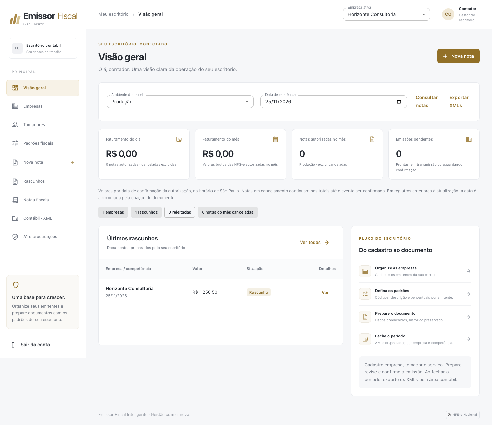

# Emissor Fiscal Inteligente

Sistema web de emissão fiscal inteligente para escritórios de contabilidade, com preenchimento automático por emitente, padrões fiscais reutilizáveis e acompanhamento das operações. Desenvolvido com backend Java 21/Spring Boot, frontend React 19/Material UI e PostgreSQL 16. Identidade visual em branco, cinza e dourado, com frontend independente na pasta `frontend/`. Código-fonte: [smart-generator-fiscal](https://github.com/robertordias/smart-generator-fiscal). O projeto completo está especificado em [Arquitetura funcional, telas e escopo](docs/ARQUITETURA.md) e no [modelo de banco PostgreSQL](docs/modelo-postgresql.sql).

**Situação atual:** aplicação executável com login de 8 horas, gestão de empresas e tomadores, padrões fiscais versionados, emissão estruturada e integração direta com a NFS-e Nacional. O backend prepara, valida e assina a DPS com A1, transmite por mTLS e acompanha autorização, rejeição, consulta e cancelamento. PostgreSQL armazena os cadastros e documentos; o formulário em andamento também é preservado no navegador.

Já foram realizadas verificações com certificado real e chamadas aos serviços oficiais, incluindo transmissões com rejeições fiscais registradas. Isso não representa homologação completa de todos os cenários. O ambiente padrão é **homologação**; produção exige configuração explícita. A3, NF-e de produtos, personalização de marca por escritório e disparos automáticos permanecem no escopo futuro.

Configuração e fluxo completo: [guia da integração NFS-e](docs/INTEGRACAO-NFSE.md).

## Prévia do sistema



Interface demonstrativa com dados fictícios e identificação adaptada para **Emissor Fiscal Inteligente**.

## Executar com Docker e PostgreSQL

A tela **Empresas** permite importar a relação de empresas em CSV, com prévia, validação por linha e gravação no PostgreSQL. Consulte [layout e regras de importação](docs/IMPORTACAO-EMPRESAS.md).

O sistema também possui [cadastro de tomadores, NBS e variações do mesmo serviço com e sem retenção de ISS](docs/SERVICOS-TOMADORES.md), reutilizados na preparação da nota.

Com Docker Desktop iniciado, na raiz do projeto:

```sh
# Somente na primeira configuração; preserve um .env já existente.
cp -n .env.example .env
```

Edite `.env` e defina `DB_PASSWORD` e `APP_ADMIN_PASSWORD` (12+ caracteres). Depois:

```sh
docker compose up --build -d
```

Abra **http://127.0.0.1:3000**, usuário **contador**, senha definida em `APP_ADMIN_PASSWORD`. O Compose executa PostgreSQL 16, Java 21 e frontend React/Nginx. O banco é persistido em volume; reiniciar os contêineres mantém as gravações. O Flyway cria e versiona a estrutura automaticamente.

Para executar só o banco no Docker, usar a IDE, transferir os dados H2 antigos ou fazer backup: [guia PostgreSQL/Docker](docs/POSTGRESQL.md). A troca de banco não importa nem apaga automaticamente os dados H2 anteriores. Os A1 migrados precisam da mesma `NFSE_MASTER_KEY` anterior.

## Abrir a interface em desenvolvimento

Pré-requisitos: Docker Desktop iniciado e Node.js 20.19+ com npm. Na raiz, configure o `.env` como descrito acima. Para usar o frontend com recarga automática e manter Java/PostgreSQL no Docker:

```sh
docker compose up --build -d postgres backend
cd frontend
npm install
npm run dev
```

Abra **http://127.0.0.1:5173**. Entre como **contador**, usando a senha `APP_ADMIN_PASSWORD` do `.env` da raiz. Essa senha autentica o gestor do sistema; certificados A1 têm sua própria senha de importação.

| Serviço | Endereço padrão |
|---|---|
| Frontend com Vite | http://127.0.0.1:5173 |
| Frontend com Docker/Nginx | http://127.0.0.1:3000 |
| Backend | http://127.0.0.1:8080/api |
| Saúde do backend e banco | http://127.0.0.1:8080/health |
| PostgreSQL local | 127.0.0.1:5432 |

O `npm run dev` inicia apenas o frontend. O backend precisa estar em execução para entrar e acessar os dados. Para iniciar novamente os serviços já compilados, execute `docker compose up -d postgres backend`. Após alterar o código Java, use novamente `--build`.

Para executar o Java pela IDE ou terminal em vez do contêiner, pare o backend Docker (`docker compose stop backend`), mantenha o PostgreSQL iniciado e, na raiz, execute com JDK 21+ e Maven 3.9+:

```sh
mvn clean verify
java -jar target/emissor-fiscal-0.1.0.jar
```

O Java carrega automaticamente o `.env` da raiz quando iniciado nesse diretório; variáveis de ambiente e argumentos podem sobrescrever os valores. Para essa execução, o banco usa por padrão `127.0.0.1` e `DB_PORT`; `DB_URL` permite indicar outra conexão. Consulte [configuração e migração do banco](docs/POSTGRESQL.md).

### Conexão recusada no frontend

Se o Vite mostrar `http proxy error` com `ECONNREFUSED 127.0.0.1:8080`, o Java não está acessível no destino configurado. Na raiz:

```sh
docker compose up -d postgres backend
docker compose ps
docker compose logs --tail=100 backend
curl --fail http://127.0.0.1:8080/health
```

A saúde deve retornar `{"status":"UP"}`. Depois, atualize a página. Se a porta já estiver ocupada, escolha uma única execução do backend (Docker ou IDE). Se configurar outra porta com `BACKEND_PORT` no Docker ou `PORT` no Java local, ajuste também `BACKEND_URL` em `frontend/.env` e reinicie o Vite.

## Recursos e fluxo atual

- **Empresas:** cadastro, busca e importação CSV de layout fixo, com prévia, validação e correção manual dos campos em modal antes de gravar os registros válidos.
- **Tomadores:** cadastro, edição e vínculo do mesmo tomador a vários prestadores. Busca de dados por CNPJ para conferência antes de salvar e preenchimento automático do endereço ao selecionar o tomador na emissão.
- **Padrões fiscais:** criação e edição de configurações por empresa, nome de serviço e vigência; LC 116, código nacional, CNAE, NBS, descrição e retenções. Permite variações do mesmo serviço com e sem retenção de ISS.
- **Emissão:** formulário em três etapas, itens com quantidade e valor unitário, descontos, pagamento, complementos, retenções e resumo. Preserva campos, seleções e etapas no localStorage por usuário e emitente ao navegar ou recarregar. A configuração de A1, procuração e enquadramento pode ser aberta em modal durante o preenchimento. Exige revisão e confirmação do CNPJ antes da transmissão.
- **A1 e procurações:** cofre criptografado, vínculo do representante aos clientes, poderes, datas opcionais da procuração e enquadramento fiscal, incluindo MEI e ME/EPP. Suporta arquivos `.pfx` e `.p12`; o cadastro local não cria uma procuração nos serviços oficiais.
- **Notas:** preparação e assinatura da DPS, transmissão, consulta, reconciliação, filtros, XML, cancelamento e histórico. A ação **Revisar DPS** permite preparar novamente um documento rejeitado com o enquadramento atualizado, preservando a identidade reservada quando permitido. DANFSe pelo portal oficial.
- **Painel:** faturamento diário/mensal de notas válidas autorizadas, quantidades, pendências e alertas de certificados, com filtros de data, emitente e ambiente.
- **Contábil · XML:** exportação em lote por período/ambiente, com XMLs oficiais, eventos de cancelamento e manifesto em ZIP.
- **Compartilhamento:** WhatsApp/e-mail com mensagem e link oficial, cópia e download/compartilhamento do XML. O envio é confirmado pelo usuário no aplicativo externo; não há disparo automático via SMTP ou API do WhatsApp.

Os dados fiscais são selecionados pelo emitente, nome da variação e competência. O backend aplica a versão vigente e grava um **snapshot imutável no rascunho**. Alterar os padrões posteriormente não modifica notas ou rascunhos anteriores. Sobrescritas de descrição ou regras fiscais exigem justificativa conforme o campo; a revisão continua necessária antes da emissão.

Fluxo de emissão: **Nova nota → Documento e destinatário → Serviços → Pagamento e emissão → Revisar emissão → Confirmar CNPJ**. A tela reúne tomador, quantidades, valores, pagamento, complementos, descontos e retenções; também permite salvar um rascunho sem transmitir. Configure A1, procuração e enquadramento em **A1 e procurações** antes de gerar a nota. O ambiente padrão continua em homologação. Consulte o [formulário de emissão](docs/FORMULARIO-EMISSAO.md) e o [painel operacional, XMLs em lote e compartilhamento](docs/OPERACAO-CONTABIL.md).

O servidor Vite encaminha `/api` ao Java em `127.0.0.1:8080`, sem precisar liberar CORS. Se o backend usar outra porta, copie `frontend/.env.example` para `frontend/.env` e ajuste `BACKEND_URL`. Para parar cada servidor, use Ctrl+C no respectivo terminal. A sessão permanece ativa por **8 horas contadas a partir do login**, inclusive ao atualizar a página ou reabrir o navegador. Usar o sistema não renova esse prazo. “Sair da conta” revoga a sessão no servidor e encerra o acesso nas outras abas. As sessões são mantidas na memória do backend; reiniciá-lo exige novo login, sem perder os registros fiscais salvos.

### Dados fiscais e preenchimento

- **Município da prestação:** busca por nome/UF com código IBGE; a opção **Usar município do prestador** fica abaixo do seletor.
- **Inscrição municipal:** configurada em **A1 e procurações → Enquadramento e numeração**; o editor de padrões oferece o atalho **Configurar IM / CCM**. O CCM de São Paulo é enviado sem pontos, espaços ou hífen, preservando os dígitos e zeros à esquerda.
- **Códigos do serviço:** código nacional e desdobramento municipal são campos separados. Por exemplo, `100104` e `001` podem ser apresentados como `10.01.04 / 001`; o código municipal é preenchido na emissão e não deve ser incorporado ao campo nacional.
- **MEI:** selecione explicitamente **MEI** no enquadramento. O formulário e o backend impedem preparação com ISS retido para MEI (E0583).
- **Percentuais:** alíquota do ISS e tributos aproximados municipais são informações independentes. O campo **Total municipal (%)** é enviado como percentual aproximado, separado da retenção.
- **Snapshots:** corrigir um padrão não recalcula rascunhos antigos. Para mudar serviço, valores ou retenções de um rascunho já preservado, gere outro com os dados corrigidos. Revisar uma DPS rejeitada atualiza sua preparação; não reescreve o conteúdo comercial do rascunho.

O localStorage preserva o trabalho em andamento nesse navegador; ele não substitui a gravação do rascunho no PostgreSQL. Cancelar o preenchimento ou obter um resultado definitivo na transmissão limpa a cópia local. Resultados de comunicação incertos mantêm os dados para consulta, sem retransmissão automática. Arquivos e senhas do A1 não são armazenados nesse mecanismo.

Detalhes de build, preview e testes: [README do frontend](frontend/README.md).

## Executar

Pré-requisitos para execução fora do Docker: JDK 21+, Maven 3.9+ e PostgreSQL configurado. Na primeira compilação, Maven precisa das dependências disponíveis em seu repositório local ou de acesso à internet.

```sh
mvn clean verify
export APP_ADMIN_PASSWORD='defina-uma-senha-forte-aqui'
java -jar target/emissor-fiscal-0.1.0.jar
```

A API estará em `http://127.0.0.1:8080/api`. A interface visual é servida separadamente pelo frontend na porta 5173; a raiz da API não possui uma página inicial. Usuário: `contador`; senha: a variável definida acima. A aplicação recusa inicialização sem senha de pelo menos 12 caracteres. O banco padrão é PostgreSQL, com conexão definida por `DB_URL`, `DB_USER` e `DB_PASSWORD`. Os dados do Docker ficam em volume persistente. O H2 anterior continua preservado em `./data/fiscal`, sem uso automático. Parar: Ctrl+C.

Configurações: `PORT`, `SERVER_ADDRESS`, `DB_URL`, `DB_USER`, `DB_PASSWORD`, `APP_TENANT_ID`. Para habilitar o usuário `cliente`, informar `APP_CLIENT_PASSWORD` (12+ caracteres) e `APP_CLIENT_ISSUER_ID` com ID de empresa já cadastrada, e reiniciar. O contador acessa o tenant configurado; o cliente acessa somente essa empresa. Gestão dinâmica de contas/tenants ainda não existe.

O login visual usa cookie HttpOnly/SameSite com prazo absoluto de 8 horas e proteção CSRF nas alterações. Defina `APP_COOKIE_SECURE=true` quando servir por HTTPS. HTTP Basic continua disponível para clientes locais da API. A autenticação atual continua voltada à base local. PostgreSQL e migrações Flyway estão implementados. Para produção permanecem os requisitos de OIDC/TLS, usuários/vínculos persistentes e os demais controles da arquitetura. O H2 fica disponível explicitamente pelo perfil `h2`, para desenvolvimento e testes.

## Exercitar o fluxo

Com o servidor iniciado, em outro terminal, defina `APP_ADMIN_PASSWORD` com a mesma senha. Os dados abaixo são apenas exemplos cadastrais, sem validade ou recomendação tributária.

```sh
curl -u "contador:$APP_ADMIN_PASSWORD" http://127.0.0.1:8080/api/me

curl -u "contador:$APP_ADMIN_PASSWORD" -H 'Content-Type: application/json' \
  -d '{"cnpj":"12345678000195","name":"Empresa de exemplo","municipality":"3550308"}' \
  http://127.0.0.1:8080/api/issuers
```

Copie o `id` retornado para `EMITENTE_ID`:

```sh
export EMITENTE_ID='id-retornado-pela-api'
curl -u "contador:$APP_ADMIN_PASSWORD" -H 'Content-Type: application/json' \
  -d '{"effectiveFrom":"2026-01-01","lc116":"01.01","nationalService":"010101","cnae":"6201501","description":"Descrição padrão do serviço","issRate":5,"irrfRate":0,"pisRate":0,"cofinsRate":0,"csllRate":0,"inssRate":0,"issWithheld":false}' \
  "http://127.0.0.1:8080/api/issuers/$EMITENTE_ID/defaults"

curl -u "contador:$APP_ADMIN_PASSWORD" \
  "http://127.0.0.1:8080/api/issuers/$EMITENTE_ID/defaults?competence=2026-11-10"
```

Criar rascunho preenchendo automaticamente os dados da empresa:

```sh
curl -u "contador:$APP_ADMIN_PASSWORD" -H 'Content-Type: application/json' \
  -H 'Idempotency-Key: exemplo-001' \
  -d "{\"issuerId\":\"$EMITENTE_ID\",\"competence\":\"2026-11-10\",\"amount\":1000.00}" \
  http://127.0.0.1:8080/api/drafts
```

Resposta contém `status: DRAFT`, `snapshot.defaults.version` e `descriptionOrigin: ISSUER_DEFAULT`. Uma descrição manual diferente exige `overrideReason`. Nova tentativa com a mesma chave e mesmo corpo retorna o mesmo rascunho; alteração do corpo retorna 409. A comparação considera a representação do valor decimal; repita o corpo original em retentativas.

Para corrigir uma configuração existente, use a edição por PUT com sua versão atual. Para uma nova vigência, publique por POST outra configuração com outra data inicial. A maior data inicial até a competência determina a versão dentro de cada nome de variação. O mesmo código pode ser cadastrado em nomes diferentes, com ou sem retenção. Uma nova vigência preserva as configurações anteriores; a edição não altera snapshots de rascunhos já criados. Duplicação de vigência para o mesmo nome retorna 409; ausência de política vigente retorna 422. Alíquotas não determinam por si só a aplicabilidade tributária; o fluxo de emissão exige revisão dos dados e validação oficial.

## API implementada

| Método | Caminho | Acesso |
|---|---|---|
| POST | `/api/auth/login` | Credenciais JSON; exige X-Requested-With: XMLHttpRequest; cria cookie de 8 horas |
| GET | `/api/auth/session` | Restaura usuário, prazo e proteção CSRF da sessão |
| POST | `/api/auth/logout` | Cookie e X-CSRF-Token; revoga a sessão |
| GET | `/api/me` | Autenticado |
| GET | `/api/dashboard?referenceDate=AAAA-MM-DD&issuerId=UUID` | Resumo de rascunhos; emitente opcional |
| GET | `/api/issuers` | Empresas autorizadas |
| POST | `/api/issuers` | Gestor |
| POST | `/api/issuers/{id}/defaults` | Gestor; cria versão |
| GET | `/api/issuers/{id}/defaults?competence=AAAA-MM-DD` | Empresa autorizada |
| PUT | `/api/issuers/{id}/defaults/{defaultsId}` | Gestor; correção com controle de versão |
| POST | `/api/drafts` | Empresa autorizada; exige Idempotency-Key |
| GET | `/api/drafts?page=0&size=10` | Listagem paginada; filtros opcionais issuerId, from e to |
| GET | `/api/drafts/{id}` | Empresa autorizada |
| POST | `/api/issuers/import/preview` e `/api/issuers/import` | Gestor; prévia e importação CSV com correções |
| GET | `/api/issuers/{id}/registration` | Empresa autorizada; dados cadastrais importados |
| GET/POST | `/api/issuers/{id}/recipients` | Consulta e cadastro de tomadores da empresa autorizada |
| PUT | `/api/issuers/{id}/recipients/{recipientId}` | Edição de tomador da empresa autorizada |
| GET | `/api/issuers/{id}/services?competence=AAAA-MM-DD` | Serviços vigentes da empresa autorizada |
| GET | `/api/office/dashboard` | Painel de notas no escopo autorizado |
| GET | `/api/office/xml/summary` e `/api/office/xml/export` | Gestor; prévia e ZIP contábil |

As rotas de certificados, procurações e documentos fiscais estão documentadas no [guia NFS-e](docs/INTEGRACAO-NFSE.md).

O login e `/health` são públicos; os endpoints de negócio exigem autenticação. O tenant é obtido do usuário, sem confiar em tenant informado pelo cliente. Campos JSON desconhecidos são rejeitados para evitar falsa impressão de processamento de dados ainda não suportados. Os percentuais aceitam 0 a 100 com até 4 casas; isso é validação estrutural, não validação fiscal. O cadastro básico manual aceita CNPJ numérico de 14 posições; importação CSV e geração fiscal verificam os dígitos. A validação cadastral não substitui as regras do ambiente fiscal oficial.

## Verificação

```sh
mvn test
```

Testes cobrem autenticação HTTP, validação estrutural, isolamento entre tenants/empresas, restrição do cliente, vigência por competência, preservação do snapshot, justificativa de sobrescrita, idempotência, conflitos de cadastro, consultas do painel e paginação/filtros de rascunhos. Não são testes de homologação fiscal. A suíte usa H2 por padrão e também pode executar no PostgreSQL com as variáveis descritas no guia. Há teste adicional da transferência entre os dois bancos.

Estrutura: `src/main/java` contém API e autenticação; `src/main/resources/db/migration/` contém os esquemas Flyway por banco; `docs` contém o escopo de produção. Nenhuma credencial ou certificado real deve ser adicionado ao repositório. Os certificados artificiais em src/test/resources/nfse são apenas de laboratório. As APIs fiscais ficam sob /api/nfse; consulte o guia de integração para configuração e limites.

## Documentação e limites atuais

- [Arquitetura e escopo planejado](docs/ARQUITETURA.md)
- [PostgreSQL, Docker, backup e transferência do H2](docs/POSTGRESQL.md)
- [Importação de empresas e correções](docs/IMPORTACAO-EMPRESAS.md)
- [Serviços, NBS e tomadores](docs/SERVICOS-TOMADORES.md)
- [Formulário de emissão](docs/FORMULARIO-EMISSAO.md)
- [Painel, exportação XML e compartilhamento](docs/OPERACAO-CONTABIL.md)
- [Integração NFS-e Nacional e configuração fiscal](docs/INTEGRACAO-NFSE.md)
- [Frontend, build e testes de navegador](frontend/README.md)

## Homologação e produção

O filtro **Ambiente do painel** altera apenas a consulta de indicadores e documentos. O ambiente de emissão é definido no servidor, no `.env` da raiz:

```env
# Desenvolvimento e testes fiscais
NFSE_ENVIRONMENT=HOMOLOGACAO
NFSE_PRODUCTION_ENABLED=false
```

Para operar em produção:

```env
NFSE_ENVIRONMENT=PRODUCAO
NFSE_PRODUCTION_ENABLED=true
```

Após alterar, reinicie o Java na IDE ou no terminal. Em Docker, recrie o backend para carregar as variáveis:

```sh
docker compose up -d --build --force-recreate backend
```

Atualize a interface, faça login novamente e confira o ambiente exibido na confirmação. Variáveis definidas na configuração de execução do IntelliJ ou no processo prevalecem sobre o `.env`. **Produção emite documentos com validade fiscal**; a mudança de ambiente não corrige automaticamente rejeições de cadastro, enquadramento ou representação.

### Série e numeração DPS

A emissão por API utiliza séries de **1 a 49999**. As séries de **70000 a 79999** pertencem ao portal Web Nacional e não devem ser copiadas para esta integração. Para uma empresa que nunca utilizou a série `1` em produção pela API, configure série `1` e último número `0`; se já utilizou, informe o último número dessa mesma série, emitente e ambiente. Não reutilize a numeração de outros emissores sem conferir o histórico.

O número DPS é diferente do número oficial da NFS-e, atribuído após autorização. Homologação e produção possuem sequências separadas. Antes da operação, configure a sequência correta do ambiente selecionado.

### Certificado e representação

O sistema usa o A1 vinculado ao prestador para assinar a DPS e autenticar a conexão. A procuração registrada na aplicação é declaratória; a autorização oficial deve corresponder ao emitente e ao CPF/CNPJ titular do certificado. E0718 indica rejeição do vínculo do assinante pela SEFIN; importar novamente um A1 ou salvar uma procuração local não garante sua resolução. O reconhecimento de uma consulta por procuração no ADN não comprova a aceitação da emissão na SEFIN.

Testes automatizados usam certificados artificiais e respostas controladas. Verificações reais de conexão e rejeições oficiais foram executadas durante o desenvolvimento; a aceitação de todos os cenários fiscais continua pendente. O conector atende ao Padrão Nacional, sem conectores municipais próprios que garantam cobertura de todo município/cenário do Brasil.

A3, NF-e de produtos, personalização de logomarca por escritório e gestão dinâmica de usuários permanecem no escopo futuro. Preserve a `NFSE_MASTER_KEY` para continuar lendo os A1 cadastrados. `.env`, certificados reais, bancos locais, dados de clientes e dependências geradas não devem ser enviados ao Git.
