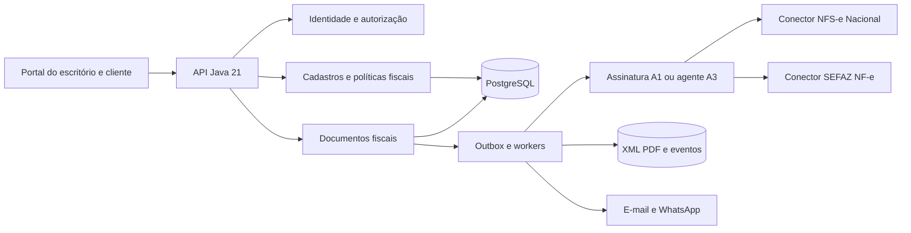
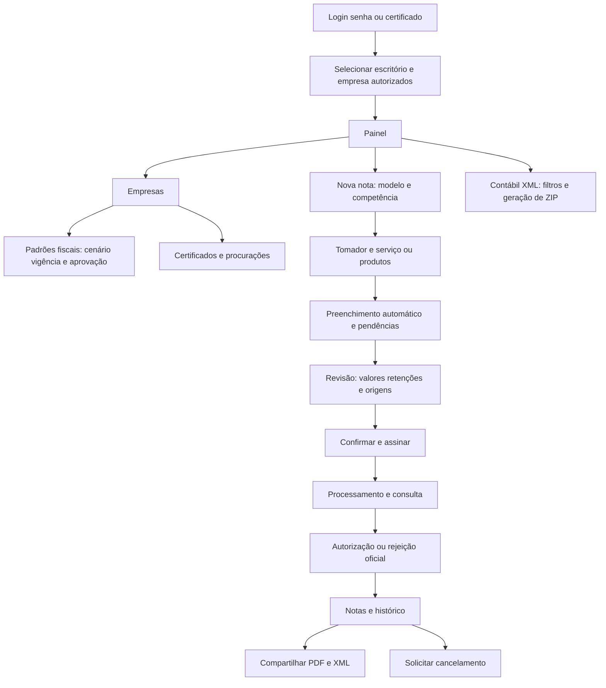

# Plataforma fiscal white-label para escritórios contábeis

Especificação funcional e técnica • referência: 10/11/2026 • Java 21+.

## 1. Entrega e limites

O produto completo é um SaaS multiempresa e multiescritório. Este repositório entrega a arquitetura, uma API executável e um frontend React/Material UI separado em `frontend/`, com login, painel de preparação, empresas, padrões fiscais versionados e rascunhos persistentes de NFS-e. A interface utiliza branco, cinza e dourado. O restante deste documento descreve o escopo a desenvolver. O conector de emissão nacional, assinatura A1, procurações, consulta, XML e eventos de cancelamento foi implementado; sua homologação no Fisco com credenciais reais ainda está pendente. Detalhes em INTEGRACAO-NFSE.md. Não há envio de mensagens nesta versão. Um rascunho nunca equivale a uma nota fiscal.

NFS-e Nacional e NF-e modelo 55 precisam de domínios, validadores, documentos auxiliares e conectores próprios. Adesão ao ambiente nacional, disponibilidade do emissor e parametrização municipal devem ser verificadas por emitente. Não assumir que todos os municípios ou operações estejam cobertos por um único endpoint.

## 2. Arquitetura proposta

### Cobertura nacional definida para o produto

O SA Trindade terá abrangência pretendida em todo o Brasil, com integração prioritária à API do Emissor Público Nacional de NFS-e. Isso define o escopo desejado, sem representar cobertura fiscal já implementada ou homologada. A versão atual inclui preparação e transmissão de DPS pela API nacional, mas ainda requer homologação oficial com credenciais reais e cobertura fiscal validada por cenário.

O roteamento da emissão deve considerar emitente, município, regime e competência, além das habilitações do serviço. Compartilhamento de documentos com o ADN não equivale, por si só, a autorização de emissão pela API nacional. Para cenários que ainda dependam de emissor municipal, será necessário um conector específico ou provedor compatível, com cobertura explicitamente validada.

Segundo o [comunicado oficial de 29/10/2026](https://www.gov.br/nfse/pt-br/noticias/nfs-e-informa-diretrizes-sobre-a-obrigatoriedade-da-emissao-da-nfs-e-nacional-para-optantes-do-simples-nacional), ME/EPP optantes do Simples Nacional devem utilizar o Emissor Nacional para competências a partir de 01/11/2026, inclusive em municípios com emissor próprio. Competências anteriores podem exigir o emissor municipal. Essa condição precisará integrar o motor de seleção do conector, sem ser generalizada para todos os regimes e períodos.

O conector nacional deverá abranger geração/validação da DPS, assinatura, autenticação do serviço, transmissão, consulta/conciliação, eventos e obtenção de XML/DANFSe. O cadastro deverá identificar o enquadramento e as credenciais necessárias por emitente; a disponibilidade será demonstrada por testes e autorização oficial antes de liberar emissão real.

Começar com monólito modular em Java 21, Spring Boot e PostgreSQL, com módulos `identity`, `tenancy`, `registry`, `fiscal-policy`, `nfse`, `nfe`, `credentials`, `accounting`, `delivery` e `audit`. Cada módulo controla suas tabelas e expõe serviços; dependências fiscais passam por interfaces. Front-end Web responsivo comunica-se por API REST com contratos OpenAPI. Escolha sugerida: React/TypeScript, sem dependência da tecnologia do front-end para o domínio Java.

Usar transações locais para gravação de nota e outbox; workers processam integração, exportação e compartilhamento. Uma fila dedicada pode ser introduzida quando o volume justificar. Evitar transação distribuída com o Fisco. Armazenar XML, PDF e protocolos em object storage privado, com checksum, versionamento, criptografia e URLs temporárias. PostgreSQL armazena metadados e relações. Redis é opcional para limites e cache; jamais é a fonte definitiva da situação fiscal.

O contexto do tenant vem da identidade autenticada e de vínculos validados no servidor. Um identificador enviado em cabeçalho ou URL nunca concede acesso. Todas as consultas, jobs, downloads, caches e logs operacionais carregam tenant e empresa. Usar chaves estrangeiras compostas e Row Level Security no PostgreSQL como defesa adicional; testar com usuários de dois escritórios e duas empresas.

## 3. Perfis e autorizações

| Operação | Gestor/contador | Cliente/empresa |
|---|---|---|
| Marca e usuários do escritório | Administrar conforme permissão | Não |
| Cadastro de empresas e vínculos | Empresas do escritório | Consultar empresa vinculada |
| Padrões fiscais | Criar/publicar novas versões | Consultar; alterações somente por permissão explícita |
| Emissão e cancelamento | Empresas autorizadas e com poderes fiscais | Empresa vinculada e com permissão |
| XML contábil | Empresas autorizadas | Própria empresa, se habilitado |
| Certificados e procurações | Administrar vínculo e estado | Próprios vínculos autorizados |

Desdobrar perfis em permissões: `issuer.manage`, `fiscal.publish`, `invoice.issue`, `invoice.cancel`, `xml.export`, `credential.manage`, `brand.manage`. Suporte operacional não recebe acesso fiscal implícito. A autorização dentro do SaaS não substitui poderes de representação reconhecidos pelo órgão fiscal.

Login por senha: hash adaptativo, recuperação com token de uso único, revogação de sessões, limites de tentativas e MFA para administração. Produção: OIDC, cookies HttpOnly/Secure/SameSite, proteção CSRF e TLS. A interface local usa sessão com prazo absoluto de 8 horas, cookie HttpOnly/SameSite=Strict e proteção CSRF vinculada à sessão, com revogação no logout. HTTP Basic permanece disponível para clientes locais da API. A aplicação é vinculada a loopback e exige senha definida no ambiente; é uma solução de desenvolvimento, sem recuperação ou cadastro de usuários. As sessões ficam na memória do processo e são encerradas ao reiniciar o backend; a implantação distribuída deverá usar um repositório compartilhado e durável.

Login por certificado: desafio aleatório, expiração curta, assinatura do desafio, validação da cadeia ICP-Brasil, revogação, titularidade e vínculo com usuário/empresa. Não aceitar um certificado enviado como mera identificação. Separar autenticação, assinatura XML e autenticação mTLS do serviço fiscal.

## 4. Módulos e requisitos verificáveis

| ID | Módulo | Comportamento e aceite |
|---|---|---|
| WL01 | Marca | Nome, cores, logo e domínio por escritório. Upload PNG/JPEG com verificação real de formato, tamanho, dimensões e reprocessamento; rejeitar conteúdo ativo. Prévia no painel e no PDF permitido. Um tenant não acessa o arquivo de outro. |
| WL02 | Documentos | Logo somente em área admitida pelo leiaute oficial; preservar chave, QR, identificação do emitente e demais campos. Se necessário, usar capa ou comprovante separado com a marca. DANFE da NF-e e DANFSe da NFS-e têm renderizadores distintos. |
| AC01 | Acesso | Gestor acessa carteira autorizada; cliente somente vínculos concedidos. Testes negativos de acesso direto a IDs e arquivos. |
| CA01 | Empresas | CNPJ, razão social, fantasia, endereços, IBGE, IM/IE, regime e enquadramentos com vigência; validar identificação e elegibilidade para emissão. Prever regras de CNPJ alfanumérico conforme especificações oficiais, sem perpetuar máscara exclusivamente numérica. |
| CA02 | Tomadores | CPF/CNPJ ou identificação estrangeira conforme operação, endereço, município/país, e-mail e telefone; dados mínimos conforme leiaute e condição de obrigatoriedade. |
| CA03 | Serviços | LC 116, código de tributação nacional, código municipal quando aplicável, CNAE, NBS quando exigido, descrição e regras por vigência. Os códigos são distintos e não intercambiáveis. |
| CA04 | Produtos/Naturezas | Produtos com unidade, NCM, origem, GTIN/CEST quando aplicáveis; naturezas com CFOP e regras de CST/CSOSN, ICMS, IPI, PIS/COFINS e novos grupos exigidos. Configuração por cenário interno/interestadual, destinatário e regime. |
| PF01 | Padrões fiscais | Configuração por emitente/modelo/competência, versionamento, aprovação, histórico e origem de cada campo. Critérios detalhados na seção 5. |
| EM01 | NFS-e | Rascunho → revisão → validação → DPS assinada → transmissão → consulta/conciliação → resultado oficial. Exibir pendências por campo e código de rejeição. Somente autorização oficial gera nota autorizada. |
| EM02 | NF-e | Itens, totais, transporte/pagamento e destinatário; XML assinado, envio à SEFAZ competente, recibo/protocolo, consulta, eventos e DANFE. Numeração e série segregadas por emitente/modelo/ambiente. |
| NO01 | Notas | Filtros por empresa, período/competência, modelo, ambiente, tomador, situação e número. Paginação, histórico de eventos, PDF e XML oficiais. Produção e homologação claramente identificadas. |
| NO02 | Cancelamento | Validar poderes, prazo, situação e justificativa conforme órgão; solicitar evento e aguardar confirmação. Recusa preserva autorização. Substituição NFS-e e eventos NF-e seguem fluxos próprios. |
| DA01 | Painel | Faturamento autorizado por dia/mês, bruto, cancelado e líquido de cancelamentos; contagem por situação. Rascunhos e rejeições fora do faturamento. Retenções não equivalem a recebimento financeiro. Filtros de competência ou autorização explicitam a base temporal e fuso. |
| ES01 | Escritório | Carteira de empresas, vínculos, pendências, vencimentos de certificados/procurações, saúde das integrações e delegações por usuário. |
| CT01 | Contábil XML | Exportação assíncrona por empresas autorizadas, período, modelo e ambiente. ZIP com XML autorizado e eventos, manifesto, hashes e contagem; relatório de ausências, sem fabricar arquivos. Link temporário e trilha de download. |
| IN01 | Integrações | Importação de cadastros, API com escopos, webhooks assinados, deduplicação, retentativas, sincronização de documentos disponíveis e conciliação. SPED/EFD e apuração são módulos futuros, não consequência automática da exportação XML. |
| CO01 | Envio | Prévia de destinatário e anexos, confirmação do operador, fila com estado e histórico de tentativas. E-mail por provedor; WhatsApp por API oficial compatível com conta e políticas aplicáveis. Link `wa.me` não envia anexos automaticamente. |

## 5. Regra central: pré-fixação por emitente

Uma configuração fiscal é uma sugestão governada pelo contador; nunca é autorização para aplicar tributação incompatível. O sistema deve reduzir digitação sem dispensar análise das condições reais da prestação.

### Estrutura da política

Identificar escritório, emitente, modelo fiscal, ambiente quando afetar a regra, regime, município de incidência, serviço/cenário, início e fim de vigência, versão, estado (rascunho/aprovada/inativa), aprovador e justificativa. Uma configuração geral por empresa pode coexistir com configurações específicas de serviço; não permitir duas regras aprovadas com a mesma prioridade para o mesmo cenário e período.

Valores: LC 116; código de tributação nacional; municipal quando aplicável; CNAE; descrição; natureza/exigibilidade do ISS; município de incidência; alíquota ISS; indicação de retenção do ISS e responsável; bases, deduções e regras condicionais de IRRF, PIS, COFINS, CSLL e INSS; enquadramentos de imunidade, isenção e suspensão com referências quando exigidas; grupos IBS/CBS conforme versão oficial aplicável. Para NF-e, usar políticas próprias por produto/operação, sem reaproveitar alíquotas de serviço.

Representar cada tributo com base, percentual, condição, mínimo/limite quando aplicável, responsável e fundamento; evitar uma única coluna de “retenção total”. Usar `NUMERIC`/`BigDecimal`, percentuais como 5.0000 para 5%, e regras explícitas de precisão e arredondamento por campo do leiaute. Não presumir que ISS e tributos federais tenham a mesma base ou que toda alíquota configurada deva ser aplicada.

### Algoritmo de preenchimento

1. Autenticar, autorizar emitente e definir modelo, competência, município, regime e serviço.
2. Carregar catálogos e regras oficiais vigentes para ambiente/leiaute. Se dados essenciais do cenário faltarem, manter pendência em vez de adivinhar.
3. Encontrar política aprovada vigente na competência. Selecionar regra de serviço/cenário antes da regra geral da empresa. Ambiguidade bloqueia; ausência abre configuração ou preenchimento assistido conforme permissão.
4. Para cada campo não informado, aplicar política específica; depois política geral; depois cadastro do serviço. Valor manual explícito prevalece somente se permitido. `null` significa ausente; zero e `false` são valores explícitos.
5. Registrar origem por campo: manual, política específica, política geral ou catálogo. Restrições legais prevalecem sobre qualquer origem. Revalidar quando tomador, município, competência, regime ou operação mudar.
6. Alteração manual sensível exige permissão, justificativa e, quando configurado, aprovação do contador. Não atualizar o padrão da empresa pela simples edição de uma nota; oferecer ação separada “criar nova versão de padrão”.
7. Mostrar tela de revisão com base, alíquotas, retenções, bruto/líquido e origem. Os números devem explicar como foram obtidos.
8. Persistir snapshot de dados, política e versão do motor/leiaute junto ao documento. Uma nova política afeta novos rascunhos; rascunhos existentes só adotam nova versão por ação explícita com comparação. Notas transmitidas não são recalculadas.

Exemplo: empresa A tem descrição “Serviços de consultoria” e ISS configurado em 5%. Ao criar nota de R$ 1.000, a descrição é sugerida e a retenção depende das condições do tomador/operação. A troca do padrão para 3% não muda documentos anteriores. Trocar para empresa B exige resolver todas as regras novamente e limpar dados herdados de A.

### Recorte implementado

A API implementa somente política geral NFS-e por emitente, início de vigência inclusivo e versões imutáveis. A política selecionada é a de maior início de vigência menor ou igual à competência; a próxima versão delimita o fim da anterior. Não permite datas iniciais iguais. Ainda não há fluxo de aprovação nem políticas específicas de serviço. Todos os percentuais são armazenados como sugestões; nenhum cálculo tributário ou validação oficial é executado.

O cliente não altera política. Na criação do rascunho, a descrição pode ser sobrescrita com justificativa; a configuração usada é copiada integralmente. A competência e o valor são obrigatórios; não há inferência da competência a partir do dia de emissão. O CNPJ do protótipo aceita somente 14 dígitos e não verifica dígitos; cadastro fiscal completo, inclusive alfanumérico, é um requisito pendente.

## 6. Fluxo de telas

Navegação lateral: Painel; Emissão; Notas Emitidas; Cadastros (empresas, tomadores, produtos, serviços e naturezas); Escritório (usuários, certificados, procurações); Contábil XML; Integrações; Configurações/Marca. Cabeçalho exibe logo, empresa ativa, ambiente e usuário.

Tela de empresas tem abas Cadastro, Configurações fiscais padrão, Certificados, Procurações, Acessos e Histórico. Em padrões, exibir comparativo entre versões, campos bloqueados, data de vigência e ação publicar. Wizard da emissão não permite avançar com erro bloqueante; rejeições preservam rascunho e explicam como corrigir. Clique duplo e reenvio após timeout não criam nova emissão.

## 7. Certificados e procurações

### Operação definida: contador como procurador, usando A1

O operador principal será o contador, que terá certificado digital A1 e procurações eletrônicas dos clientes. O fluxo prioritário de emissão será a atuação por representação: o contador seleciona o cliente, o sistema resolve seus padrões fiscais e identifica o A1 e os poderes do representante. A empresa cliente permanece como prestadora identificada na DPS/NFS-e; o contador atua como representante autorizado. Não substituir os dados do prestador pelos do escritório.

O [comunicado oficial sobre representação nas APIs de NFS-e](https://www.gov.br/nfse/pt-br/noticias/nova-funcionalidade-possibilita-representacao-e-alternancia-de-perfis-na-nfs-e) informa suporte à atuação em nome de terceiros mediante procuração eletrônica válida para os serviços da NFS-e, com validação pelo certificado de comunicação e pelas assinaturas dos documentos. Assim, a procuração deverá contemplar os serviços aplicáveis e seu outorgado deverá corresponder à identidade do certificado utilizado; uma procuração genérica ou somente cadastrada no SA Trindade não será presumida suficiente.

Por escritório, cadastrar os metadados e a referência protegida do A1 do representante, permitindo vinculá-lo a vários clientes com autorização própria por emitente. Por procuração, controlar cliente/outorgante, CPF/CNPJ do outorgado, serviços/poderes, validade, evidência e estado de verificação. Diferenciar os poderes necessários para emissão, consulta/distribuição e eventos conforme os serviços oficiais.

Antes de transmitir, validar vigência do A1, identidade do outorgado, procuração aplicável, permissão do operador, dados da DPS e disponibilidade da integração. Ausência, expiração ou recusa de representação bloqueia a operação e informa a pendência. A trilha registra operador, cliente, certificado, referência da procuração, ação e retorno oficial, sem registrar chave privada ou senha. A1 é a prioridade da primeira integração; A3 permanece como evolução posterior do produto. Esses fluxos foram implementados no conector e ainda precisam ser homologados com A1 ICP-Brasil e procurações reais.

A1: importar PKCS#12 após validação de cadeia, validade, titularidade e senha. Criptografar material privado com chave envelopada por KMS/Vault; senha não aparece em banco em texto, respostas, logs ou backup sem proteção. Isolar uso por tenant/empresa, auditar assinatura e permitir rotação/revogação. Preferir serviço de assinatura separado. Avisos de vencimento com antecedências configuráveis.

A3: token/cartão permanece com o usuário; exigir agente local autenticado com PKCS#11 e desafios de assinatura vinculados ao hash exato do documento, sessão e prazo. Navegador comum não acessa livremente tokens. A autenticação mTLS também precisa de estratégia compatível (agente/proxy ou assinatura remota homologada); assinar XML isoladamente não resolve o transporte. Validar viabilidade por provedor, SO e órgão em uma prova técnica antes de prometer operação desassistida. PIN não é armazenado no servidor.

Procuração: armazenar outorgante, outorgado, órgão/serviço, escopo, referência externa, evidência, vigência, revogação e última verificação. O cadastro local é inventário, não cria procuração no órgão. Antes de emitir, conferir autorização no SaaS, certificado aceito, titularidade e representação admitida pelo serviço. Não presumir que uma procuração aceita em um órgão vale para todos os serviços.

## 8. Ciclo fiscal e integridade

Estados de emissão: RASCUNHO → VALIDADO → AGUARDANDO_ASSINATURA → ENFILEIRADO → TRANSMITINDO → AUTORIZADO ou REJEITADO. Timeout resulta em RESULTADO_INDETERMINADO, seguido de consulta pela identidade do documento antes de reenviar. Erro de rede não significa rejeição fiscal. Guardar identidade da DPS/NF-e, número/série, hash assinado, ambiente, recibo, protocolo e respostas originais.

Cancelamento tem solicitação/evento independente: SOLICITADO → EM_PROCESSAMENTO → ACEITO ou REJEITADO. Somente evento aceito muda a situação efetiva para CANCELADO. Substituição liga nota anterior à sucessora e preserva ambas. Transições protegidas por versão otimista e locks em alocação de numeração. Chaves de idempotência vinculadas ao tenant, operação e hash do pedido; payload diferente com a mesma chave recebe conflito.

Camadas de validação: formato e obrigatoriedade; identificação cadastral; regras tributárias e condicionais; schemas XSD; assinatura/cadeia; requisitos de representação; validação oficial remota. Publicar pacotes de regras e catálogos com versão, hash, fonte, ambiente e início de vigência. Nunca anunciar conformidade estrita apenas por passar no XSD. Homologação e produção podem usar versões distintas.

## 9. Banco de dados essencial para produção

O arquivo `modelo-postgresql.sql` complementa esta especificação com chaves compostas, relacionamentos e índices. É um modelo de referência, separado das migrações realmente executadas em src/main/resources/db/migration/. PostgreSQL e Flyway estão implementados, com alternativa H2 para testes. Políticas RLS, histórico completo de todos os módulos, tabelas de domínio e constraints adicionais de vigência continuam no escopo de produção.

| Entidade | Dados e relações essenciais |
|---|---|
| tenant / brand | Escritório, domínio verificado, tema e referência de logo privado |
| app_user / membership / issuer_access | Identidade global, papel no escritório e empresas autorizadas |
| issuer / issuer_tax_profile | CNPJ e inscrições, município; regime e enquadramentos com vigência |
| party / product / service / operation_nature | Cadastros segregados por tenant e empresa quando necessário |
| fiscal_policy / fiscal_tax_rule | Versão por emitente/modelo/cenário; tributos, condições e aprovação |
| certificate / issuer_certificate / power_of_attorney | Metadados, referências secretas, vínculos e poderes por órgão |
| fiscal_document / fiscal_item / document_tax | Modelo, competência, totais, snapshot, itens e tributos resolvidos |
| document_event / fiscal_attempt | Eventos oficiais e tentativas de comunicação sem apagar histórico |
| document_artifact | Tipo XML/PDF/evento, hash, tamanho e chave privada do storage |
| outbox / export_job / export_item | Processamento confiável e exportações rastreáveis |
| delivery / delivery_attempt | Destino, canal, estado e IDs do provedor; anexos referenciados |
| audit_event | Ator, tenant, recurso, ação, instante, justificativa e correlação |

Todos os valores monetários usam NUMERIC; códigos fiscais são strings. Datas de competência usam DATE; instantes usam TIMESTAMPTZ. Consultas financeiras definem explicitamente fuso America/Sao_Paulo ou o fuso configurado do emitente. Cadastros referenciados não são apagados fisicamente; documentos e eventos fiscais permanecem íntegros. Proteger auditoria contra alterações e definir retenção por categoria documental e obrigação aplicável, com validação contábil/jurídica.

## 10. Requisitos não funcionais

- Segurança: autorização no servidor, isolamento testado, proteção contra upload malicioso/SSRF, segredos em cofre, TLS, criptografia e revisão de dependências antes de produção.
- LGPD: minimização, inventário de finalidades e acessos, atendimento a titulares e retenção vinculada às obrigações fiscais; não apagar documentos sujeitos a guarda apenas por solicitação automática.
- Observabilidade: correlation ID, métricas de autorização/rejeição, latência externa, fila, falhas e vencimentos; mascarar documentos, e-mails, tokens e XML sensível em logs.
- Recuperação: backups criptografados com restauração ensaiada, PITR no banco, versionamento de objetos. Metas iniciais a validar: RPO 15 min e RTO 4 h.
- Desempenho proposto: p95 < 500 ms para consultas paginadas internas sob carga acordada; operações externas são assíncronas e não têm SLA de autorização controlado pelo produto. Carga inicial de referência: 100 escritórios, 10 mil empresas e 50 requisições/s, a confirmar em teste.
- Acessibilidade: teclado, foco, contraste, mensagens ligadas aos campos e responsividade. Exportações grandes por streaming/worker com limites por tenant.

## 11. Escopo de desenvolvimento e critérios de liberação

| Etapa | Entregas | Dependência e condição de aceite |
|---|---|---|
| 0 — Descoberta fiscal | Matriz municípios/UFs/modelos, operações, regimes, volume, poderes e catálogos | Contador responsável aprova cenários e versões oficiais |
| 1 — Fundação | Tenant, usuários/OIDC, permissões, marca, empresas, cadastros e auditoria | Testes de isolamento e restauração; sem emissão |
| 2 — Motor fiscal | Políticas aprovadas, vigência, cenários, cálculo e snapshots | Exemplos tributários aprovados, arredondamento, alterações e histórico testados |
| 3 — NFS-e Nacional | A1, DPS, assinatura, mTLS, transmissão, consulta, eventos e DANFSe | Evidência de autorização, rejeição, timeout, cancelamento e reconciliação em ambiente de testes |
| 4 — Operação contábil | Painel, XML lote, compartilhamento e integrações | Exportação íntegra, acessos e entregas rastreáveis |
| 5 — NF-e | Cadastros de produtos, motor próprio, SEFAZ, DANFE, eventos | Homologação por UF/cenário incluído no contrato e cenários fiscais aprovados |
| 6 — A3 e produção | Agente local, procurações verificadas, hardening e operação | Matriz de compatibilidade, pentest, observabilidade e recuperação ensaiada |

A3 e validação de representação exigem prova técnica desde a etapa 0, mesmo que a entrega operacional venha depois. Estimativa de esforço só deve ser fechada após cobertura de municípios/UFs, volume e cenários fiscais. Não incluem inicialmente: folha, escrituração/apuração completa, SPED, NFC-e, CT-e, MDF-e, NFS-e de modelos municipais fora da cobertura contratada ou consultoria tributária automatizada.

Critério global: nenhuma nota é marcada autorizada sem resposta oficial verificável; não duplicar emissão em timeout; nenhuma alteração de configuração modifica snapshot anterior; nenhum usuário de outra empresa/escritório lê documentos ou arquivos; PDFs seguem especificação aplicável; execução reproduzível em Java 21.

## 12. Fontes oficiais e manutenção

- [NFS-e: documentação atual de produção](https://www.gov.br/nfse/pt-br/biblioteca/documentacao-tecnica/documentacao-atual/documentacao-atual): manuais, domínios, leiautes e XSD. Página consultada em 10/11/2026, com atualização indicada em 04/11/2026.
- [NFS-e: produção restrita](https://www.gov.br/nfse/pt-br/biblioteca/documentacao-tecnica/producao-restrita): regras e leiautes de testes; não transferir automaticamente versões para produção.
- [Portal NF-e: documentos e manuais](https://www.nfe.fazenda.gov.br/portal/principal.aspx): consultar MOC, notas técnicas, schemas e regras aplicáveis antes da implementação do conector.

Esta arquitetura é uma proposta de engenharia. Os manuais não foram transcritos integralmente para código. O catálogo de regras precisa ser implementado e homologado por cenário; documentos oficiais e versões implantadas pelo órgão prevalecem sobre parâmetros locais.
